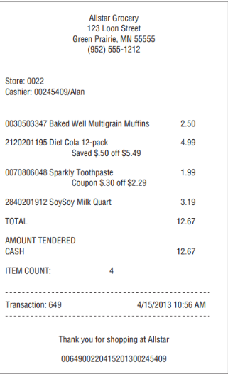
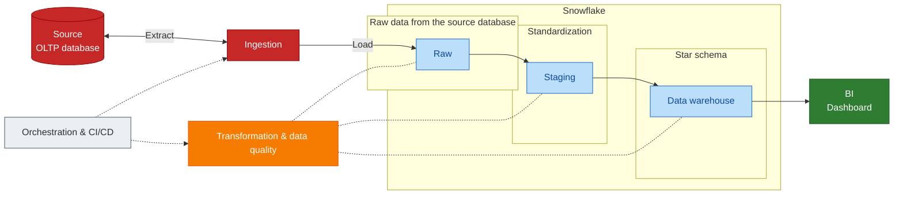
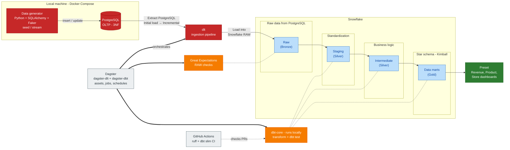
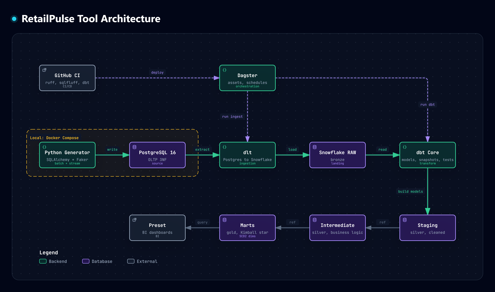

# Retail Pulse

**From a receipt to a profit dashboard: building an end-to-end retail data pipeline.**

PostgreSQL → dlt → Snowflake → dbt → Dagster → Preset, checked with Great Expectations and GitHub Actions. Runs on a single laptop.

Every time you pay at a supermarket, a receipt like the one above is created. For the shopper, it is a scrap of paper to throw away. For a retail chain, it is a gold mine: each line says **what was sold, how many, where, when, at what price, and whether a promotion applied**.

The problem is that this gold mine is scattered across the database of the point-of-sale (POS) system, which is designed for fast writes, not for analysis. This project goes all the way from there to a dashboard that answers questions like:

- Which stores and which products are the most profitable?
- Which promotions actually work, and which just give money away?
- If cost of goods rises 3%, how does profit change?

Customers, inventory, returns and cancellations are out of scope, to focus on getting one process right: **sales**.

> **Ingestion scope:** incremental on the `updated_at` column (batch). Log-based CDC (Debezium, Redpanda) is not done; see [Project-Spec](./docs/Project-Spec.md).
> **Documentation:** the phase roadmap, run guides and design docs are in [docs/README.md](./docs/README.md).

# 1. Start from the source: the operational data model

Before thinking about the warehouse, you need to understand what the source data looks like. The simulated POS system is modeled in three steps: Conceptual (which entities exist) → Logical (3NF, 10 tables) → Physical (PostgreSQL).

The focus is on two tables: `sales_transaction` is the **header** (one checkout), and `sales_transaction_item` is **each line** on the receipt. Every revenue analysis starts from these line items.

Diagrams and design rationale: [Operational data model](./docs/design/operational-data-modeling.md). On the warehouse side: [Analytical model](./docs/design/analytical-data-modeling.md).

# 2. Architecture: think of a restaurant

The easiest way to picture the pipeline is a restaurant. **Ingredients** (raw data) arrive at the storeroom, get **prepped** (cleaned, standardized), **cooked** (business logic applied), then **plated** (star schema) for the guests (dashboards). A manager stands outside and handles the schedule, and a quality inspector checks every stage.

## A. The big picture

One main path from left to right. The two blocks at the bottom hold no data; they control the other blocks.

## B. Mapped to real tools

The same flow, but each box is a specific tool. Bronze, Silver and Gold are the names from the Medallion architecture: the further right, the cleaner the data and the closer it is to the business question.

# 3. Key decisions

A few choices shape the project. Here they are, with the reasons:

- **RAW is append-only and never overwritten.** When a product's price changes, dlt adds a new row instead of editing the old one. History is never lost, and it is the raw material for SCD2. The cost: deleting RAW loses history for good, so every command that can delete RAW carries a warning in the docs.
- **SCD2 is built by hand with window functions, not `dbt snapshot`.** With append-only data, comparing each row with the previous one (`LAG`) yields validity ranges while keeping every step under control. A transaction is always tied to the cost of goods **at the exact time of sale**.
- **Only `completed` transactions reach analytics.** The filter sits in staging, so no later layer has to remember the `status` column.
- **No special patch logic for late-arriving data.** A fact row that cannot match a dimension gets key `-2` ("Unknown"). It is fixed by rebuilding the fact table (`--full-refresh`) instead of complicating the incremental step.
- **Every change goes through a pull request.** CI runs dbt against a separate database and builds only what changed (slim CI), so it never touches real data.

# 4. What the project includes

The image below shows the same pipeline by tool: data flows left to right in the middle row, dbt builds the Snowflake layers in the bottom row, and Dagster and GitHub CI sit on top as the control layer.

> The image comes from the original design, so it differs from reality in three ways: CI now has `ruff`, `pytest` and slim CI (no `sqlfluff` yet, no automatic deploy yet); dbt does not use snapshots (SCD2 is built by hand with window functions); Great Expectations is not in the image yet.

| Tool | Role |
| --- | --- |
| Python generator (SQLAlchemy, Faker) | Seeds historical data, simulates price changes, employee store transfers and new sales |
| PostgreSQL 16 (Docker Compose) | OLTP source database, 3NF |
| dlt | Incremental loads from PostgreSQL into Snowflake RAW |
| Snowflake | RAW, staging, intermediate and marts layers |
| dbt Core | Staging, intermediate, marts, SCD2 dimensions, tests |
| Dagster | Orchestrates dlt, dbt and quality checks as assets, jobs and a daily schedule |
| Preset | BI dashboards on the marts |
| Great Expectations | Data quality checks on RAW |
| GitHub Actions | `ruff` lint, `pytest` with PostgreSQL, slim CI for dbt, `main` branch protection |

CI has `ruff`, `pytest` and slim CI for dbt; there is no CD or `sqlfluff` yet. Run `make check` before opening a PR.

Want to try it? Start at [docs/README.md](./docs/README.md): it has the phase roadmap and quick-start commands.
