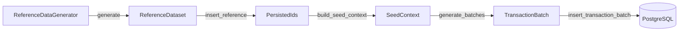
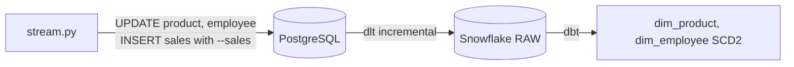
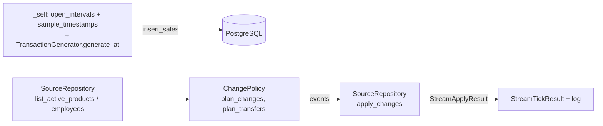

# Data generator: `seed.py` and `stream.py`

When splitting a data generation script into several classes, the hardest question is not "what should the classes be called" but:

> **At each step, what shape is the data in, where does it live, and what does the next step need to receive?**

The project has two data generation jobs with two different purposes, so their designs differ too:

| | `seed.py` | `stream.py` |
|---|---|---|
| Purpose | Build the initial base data | Simulate changes on existing data, and (optionally) new sales |
| Volume | Large (~100k transactions) | Small (a few products per run, a few hundred transactions if `--sales` is on) |
| Tables affected | All | `product`, `employee`, and `sales_transaction*` when `--sales` is on |
| Operation | `INSERT` | mostly `UPDATE`; `INSERT` of transactions when `--sales` is on |

How to run each job is in [phase 2](../phases/02-historical-seed.md) and [phase 4](../phases/04-product-change-simulator.md).
This page explains **why the code is split the way it is**. Both jobs share one way of looking at things: each component has **state** (what it holds),
**behavior** (what it does) and **output** (what it returns).

# Part 1: `seed.py`

## The big picture



| Step | Component | Input | Output |
|---|---|---|---|
| 1 | `ReferenceDataGenerator.generate()` | `SeedConfig`, `RandomSource` | `ReferenceDataset` |
| 2 | `SeedRepository.insert_reference()` | `ReferenceDataset` | `PersistedIds` |
| 3 | `build_seed_context()` | dataset, ids, config | `SeedContext` |
| 4 | `TransactionGenerator.generate_batches()` | `SeedContext` | iterator of `TransactionBatch` |
| 5 | `SeedRepository.insert_transaction_batch()` | `TransactionBatch` | `InsertStats` |

`SeedCoordinator.run()` only chains these five steps in the right order; it holds no data generation logic.

The whole design comes down to one rule: **each object holds data in exactly one state.**

```text
ReferenceDataset  →  data not yet written to the DB, identified by business key
PersistedIds      →  mapping business key → real ID assigned by the database
SeedContext       →  lookups pre-indexed by ID for generating transactions
TransactionBatch  →  one batch of transactions waiting to be written
```

With these boundaries clear, each step can be tested on its own.

## Component by component

| Component | What it does | Design point worth remembering |
|---|---|---|
| `ReferenceDataGenerator` | Creates reference data (store, employee, product, promotion, payment method) **in memory** | Does not touch the database. Data has only business keys (`store_name`, `product_sku`...), no IDs yet |
| `ReferenceDataset` | Groups the unwritten `*Draft` collections | `dataclass(frozen=True)`: it is the repository's input, so there is no reason for it to change midway. Relations between drafts go through business keys because IDs do not exist yet |
| `SeedRepository.insert_reference` | Writes reference data to the DB, returns `PersistedIds` | The only place (together with `insert_transaction_batch`) that talks to the DB. Write order follows foreign keys (`store` → `employee`, `category` and `brand` → `product`); `flush()` to get IDs. Reset (TRUNCATE) and writing reference data happen in **one transaction** |
| `PersistedIds` | Bridge from business key to real ID | The generator that creates a store only knows `store_name`; `store_id` is assigned only after writing to the DB, and every child table must reference that ID. `employee` and `promotion` have no business key in the schema, so they are mapped by **order** (`list[int]`) |
| `build_seed_context` | Turns the dataset and ids into fast lookup structures | A **pure function**, no I/O, easy to test with fake data. The join between employee and store happens **once, here**, so the loop that generates hundreds of thousands of transactions does not look it up again |
| `SeedContext` | `employees_by_store` (with hire and termination dates), `promotions_by_product` (with validity), `product_prices`, payment weights | Holds only IDs and indexes, exactly what the generator needs; it does not hold the original object lists again |
| `TransactionGenerator` | Sales logic | Reads only `SeedContext`, never touches the DB. `generate_batches` returns an **iterator**: it writes as it generates, so memory stays flat with ~100k transactions. `generate_at` lets `stream.py` reuse the exact same sales rules |
| `SeedRepository.insert_transaction_batch` | Writes one batch | **One batch is one DB transaction**: commit after each batch, roll back the whole batch on error. `TransactionBatch` holds ready-made dicts for bulk insert (~100k orders, ~280k lines) |
| `SeedCoordinator` | Chains the steps, logs progress | Thin; `main()` only reads the config and calls `run()` |

**Price at the time of sale:** a line item's `regular_price` is a snapshot taken at generation time. When `stream.py` later changes a product's price, old transactions
keep the old price, just like a real POS system.

**Transaction status:** 95% `completed`, 2% `cancelled`, 3% `returned`. The `updated_at` of a cancelled transaction is a few dozen minutes after the sale,
and that of a returned transaction a few days after, so the data has rows whose `updated_at` is earlier or later than the receipt, like a real system.

## Common design mistakes

| Mistake | Consequence | How to avoid it |
|---|---|---|
| Building `SeedContext` straight from the generator | The context holds data without real IDs | Always go through `PersistedIds` |
| Generator commits to the DB itself | Hard to test, hard to roll back | All DB operations go through `SeedRepository` |
| Using `Faker()` or `random` all over the place | Data cannot be reproduced | All randomness goes through `RandomSource` (wraps a seeded `random.Random` and `Faker`) |
| Returning the whole transaction list at once | Uses a lot of memory | Return `Iterator[TransactionBatch]` |
| Config has both `end_date` and `days` | The two values drift apart easily | Keep `start` and `days`, derive `end_date` |

# Part 2: `stream.py`

## Role: create changes, not record history

`stream.py` **does not do SCD2**. It only runs `UPDATE` on the source PostgreSQL: mainly changing `unit_cost`, sometimes `unit_price`, and moving
a few employees to another store. Keeping history belongs to two other components:
- `dlt` carries the changed data to Snowflake (incremental on `updated_at`);
- dbt builds the old and new versions (SCD2) from the appended rows in RAW.



Because `updated_at` is maintained by a database trigger, the Python code **does not need to set** this column; a plain `UPDATE` is enough for dlt to see
that the row changed.

## How one cycle runs



`StreamRunner.run_once()` follows a fixed order: read the current state, **sell first** (if `--sales` is on), then plan price changes and
employee transfers, then write. Selling before changing prices means new transactions use the current price; the new price takes effect only from this point on.

| Component | What it does | Design point worth remembering |
|---|---|---|
| `StreamConfig` | Parameters: products per cycle, price change range, probability of changing the selling price, number of employees to transfer, number of sales transactions | `price_change_probability` expresses "prefer changing cost, rarely change the selling price": every selected product changes `unit_cost`, only ~10% also change `unit_price` |
| `ProductRecord`, `EmployeeRecord` | Snapshot of the current state read from the DB | Just data |
| `ProductChangeEvent`, `EmployeeTransferEvent` | Describe **one specific change**, including old and new values | Separating the event from the `UPDATE` step: the policy only **decides**, the repository only **executes**, and the log prints the event directly so you see "changed from what to what" |
| `ChangePolicy` | All the business rules, no DB, no I/O | `plan_changes` is a pure function; a list of fake products is enough to test it |
| `SourceRepository` | The only class in `stream.py` that talks to PostgreSQL | `apply_changes` runs in **one transaction**: all succeed or all roll back. Does not set `updated_at` |
| `StreamRunner` | Orchestrates, holds no rules | Takes a `clock` from outside (defaults to the current time) so sales can be tested with a fake clock |

**`ChangePolicy` rules:**

| Rule | Purpose |
|---|---|
| Pick at most `max_products_per_tick` products, **sorted by `id` before picking** | Small change volume; the same data and the same `--seed` give the same result |
| `unit_cost` changes within `cost_change_pct_min..max` (up or down), rounded to 100 VND | Realistic, not sudden, movement |
| If the change is too small relative to the rounding step, still move **at least one step** | `unit_cost` always changes; otherwise the cycle creates no new version |
| `unit_price` changes only with probability `price_change_probability`, rounded to 1,000 VND | The selling price changes less often than cost |
| A lowered selling price never goes below the current cost; the new cost is capped by the new selling price; no value is negative | No absurd negative margins |
| `employees_per_tick` active employees move to a store **other than** their current one | Produces `store_id` changes to build history for `dim_employee` |

**Optimistic check in `apply_changes`:** the `UPDATE` statement has a condition on the old values (`WHERE unit_cost = :old AND unit_price = :old`). If another
process has just modified that row, the whole cycle rolls back. Cheap, and safe if two processes are run at the same time by mistake.

**Sales:** `open_intervals(start, end)` and `sample_timestamps(rng, intervals, n)` are **two pure functions** (no DB, no clock), so
they can be tested with fake times. How opening-hour intervals are chosen is detailed in [phase 4](../phases/04-product-change-simulator.md#extra-sales---sales-n).

## A note on SCD2 when designing change frequency

Incremental ingestion on `updated_at` only sees **the state of a row at the moment ingestion runs**. If a product's price changes 3 times between two
ingestions, the two intermediate states are lost. Consequence: **each `stream.py` cycle must be ingested before the next cycle runs**. The code has no cooldown;
this discipline lives in how you run it. It is also where this differs from real CDC, which captures every intermediate change.

Classes such as `PriceCalculator`, `EventPublisher` or `ChangeValidator` are not needed yet. With a scope of "change prices, transfer employees, add sales", adding them
would only make the code heavier than the real need.

# Part 3: Code layout and testing

```text
src/retail_pulse/generator/
├── common.py   RandomSource (seeded random.Random + Faker, chance, signed_pct), round_to_step, TZ
├── seed.py     SeedConfig, *Draft, ReferenceDataset, ReferenceDataGenerator, PersistedIds, SeedContext,
│               build_seed_context, TransactionBatch, TransactionGenerator, InsertStats, SeedRepository,
│               SeedCoordinator, main
└── stream.py   StreamConfig, ProductRecord, EmployeeRecord, ProductChangeEvent, EmployeeTransferEvent,
                StreamApplyResult, StreamTickResult, ChangePolicy, open_intervals, sample_timestamps,
                SourceRepository, StreamRunner, main
```

Both jobs take a `session_factory` from outside (`SeedCoordinator.from_config`, `StreamRunner.from_config`). Real runs use `SessionLocal`; tests
pass a session factory that points to the test database.

## Testing

```bash
make test                 # = make up + uv run pytest
uv run pytest -k seed     # seed tests only
```

**Test database.** `tests/conftest.py` creates a separate database `<PG_DB>_test` (change it with `PG_TEST_DB`) on the running Postgres, loads
`infras/postgres/init/01_schema.sql`, TRUNCATEs every table after each test and drops the database at the end.
- *Why not SQLite:* the schema relies on PostgreSQL-specific features (the `retail` schema, IDENTITY, the `updated_at` trigger,
  order-preserving `INSERT ... RETURNING`).
- *Why not "roll back after each test":* the generator commits per transaction itself, and that is exactly the behavior under test.
- If Postgres is not running, tests that need the DB are skipped; unit tests still run.

| File | No DB needed | DB needed |
|---|---|---|
| `tests/test_seed.py` | reproducible dataset; dataset shape; `build_seed_context` maps keys to IDs; batching and reproducibility; supports fewer than 8 products; parameter validation | reference row counts; transaction count close to target; `product_name` matches brand; consistent transaction data (employee at the right store and employed, promotion still valid, no orphan FKs); sale dates within the configured window; refuses a DB that has data, `--reset` reproduces the previous data |
| `tests/test_stream.py` | reproducible by seed; number of selected products capped by those available; employees moved to another store, and skipped when there is only one store; range and rounding; probability of changing the selling price; no negative margin; always moves at least one step; `open_intervals` keeps only opening hours; `sample_timestamps` within range, sorted, reproducible; parameter validation | one cycle changes exactly the selected products; whole cycle rolls back on error; runs N cycles with `time.sleep` mocked; empty DB gives a clear error; employees moved to another store; no INSERT without `--sales`; with it, new transactions fall within opening hours; sales skipped when no opening hours have passed yet |

There are no tests for customers or the `pending` status: the customer domain is out of scope, and the only valid statuses are `completed`,
`cancelled`, `returned`.

# Summary

Both jobs follow the same principle: **each object holds data in exactly one state, and each class has exactly one responsibility.**

```text
seed.py    →  large-volume INSERT:  ReferenceDataset → PersistedIds → SeedContext → TransactionBatch
stream.py  →  small-volume UPDATE:  ProductRecord → ProductChangeEvent → StreamApplyResult (plus INSERT of transactions with --sales)
```

The **decision** part (generator, policy) is separate from the **database write** part (repository), and a thin orchestration layer (`SeedCoordinator`,
`StreamRunner`) connects the steps. As a result, each part can be tested on its own, and both jobs share `RandomSource` and the same way of connecting to the database.
