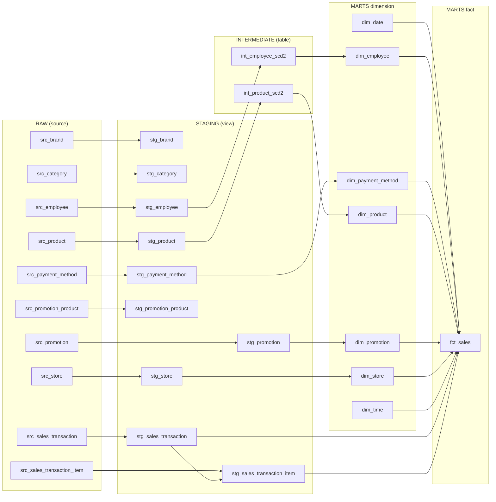
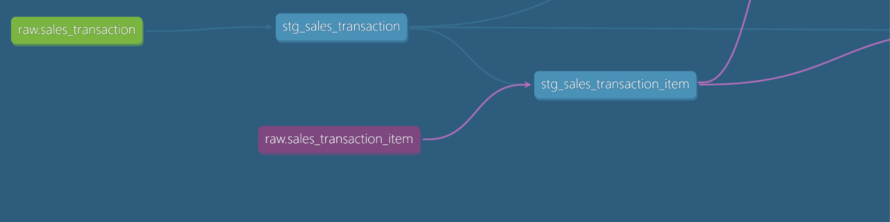

# Phase 5: dbt (Snowflake RAW → staging → intermediate → marts)

Goal: turn the RAW data loaded by dlt into a star schema for sales analysis. dbt goes through four layers, one job each,
like a restaurant: **staging** is prepping the ingredients, **intermediate** is cooking the base (SCD2), **marts** is
plating for the dashboard. Each step below can be checked on its own with `dbt build -s <layer>`.

In total there are 20 models (10 staging, 2 intermediate, 7 dimensions, 1 fact) and 148 tests; a full-project
`dbt build` reports `PASS=168` (168 is models plus tests).

## Why it is needed

RAW holds what dlt loaded: copied rows, every version of every product, keys instead of names, and all three
transaction statuses. Preset cannot use that directly: summing RAW would count returns and copies, and profit would use
today's cost for last year's sales. dbt turns RAW into a star schema with one fact table (`fct_sales`) and its
dimensions, keeps only `completed` transactions, and builds the product and employee history (SCD2) so each sale uses
the cost and store valid at that moment. Every model is SQL in git with tests, so a rule is written once and checked on
every build. It reads RAW and never writes to it.

## Concepts

| Term | Meaning here |
|---|---|
| Staging | One view per RAW table: rename, cast, drop `_dlt_*` columns, remove copies, keep only `completed` sales. No joins, no business logic |
| Star schema | A fact table of measures (`fct_sales`) surrounded by dimension tables (`dim_product`, `dim_store`, ...) it joins to by key |
| Grain | What one fact row means: one line item of a `completed` transaction (`transaction_id`, `line_number`) |
| SCD Type 2 | A dimension that keeps one row per version with `valid_from`, `valid_to` and `is_current`. Built in `int_product_scd2` and `int_employee_scd2` with window functions |
| Surrogate key | A key made by the warehouse; for a Type 2 dimension a hash of `id` and `valid_from`, so each version has its own key. The fact stores it, which pins the version valid at the time of sale |
| Incremental model | `fct_sales` only processes rows newer than what it already holds and merges them on `(transaction_id, line_number)`, instead of rebuilding the table |
| Materialization | How dbt stores a model: view (staging), table (intermediate, dimensions) or incremental (`fct_sales`) |
| Data test | A query that returns bad rows; zero rows means pass. `dbt build` runs them after each model |
| Model contract | The column names and types a model promises to return, declared in YAML. With `contract: {enforced: true}` dbt checks the query against it before creating the table and fails on any difference |

## Step 1: Connection and `dbt debug`

The dbt project lives in `dbt/` and uses dbt-core 1.12 and the Snowflake adapter in `.venv` (installed with `uv`). Your
machine may have another dbt in `~/.local/bin` (for example version 2.0.6); this guide always runs the `.venv` one through
`uv run`. dbt logs in with a key pair as user `DBT_TRANSFORMER`, role `TRANSFORMER` (created in
[phase 3](03-ingestion-snowflake.md)).

| File | Role | Commit? |
|---|---|---|
| `~/.dbt/profiles.yml` | **How to connect**: account, user, key, role, warehouse. Outside the repo, one per person; template in `dbt/profiles.yml.example` | No |
| `dbt/dbt_project.yml` | **Project content**: folder paths, `vars`, materialization and schema per layer | Yes |
| `dbt/macros/generate_schema_name.sql` | Overrides schema naming (see below) | Yes |
| `dbt/macros/surrogate_key.sql` | Builds surrogate keys for dimensions (step 5) | Yes |
| `.env` | Values for `env_var()` (`SNOWFLAKE_ACCOUNT`, `DBT_PRIVATE_KEY_PATH`) | No |
| `.snowflake/*.p8` | Private key | No |

Copy the content of `dbt/profiles.yml.example` into `~/.dbt/profiles.yml`. If the file already has other profiles,
**append to the end**. Do not overwrite the whole file. Then check:

```bash
set -a && . ./.env && set +a && cd dbt && uv run dbt debug
```

*Why load `.env` by hand:* dbt does not read `.env` itself, and the profile uses `env_var()` so it holds no secrets.
*If you skip it:* `env_var ... not found`. (The dbt extension in the IDE also shows this error because it does not read
`.env`. The file is fine; it works in the terminal.)

| Output section | Meaning |
|---|---|
| `Debugging profile` | Found the `retail_pulse` profile; missing environment variables show up here |
| `Debugging connection` | Parameters dbt will use: account, user, database, warehouse, schema, role |
| `Connection test: OK` | Logged in to real Snowflake with the key |
| `All checks passed!` | Everything passed |

### Two configuration decisions

**`threads: 4`:** the number of models run in parallel. It is limited by the DAG (dependent models must wait for each
other) and by the XSMALL `RETAIL_WH` warehouse, which queues queries. More threads only help when the DAG has many
independent branches. To go faster, consider the warehouse size first.

**One schema per layer, overridden by `generate_schema_name`.** By default dbt joins `target.schema` with the declared
schema (`DBT_PHUCLH_STAGING`). The project macro drops that join for the `prod` target only, so production schemas are
exactly `STAGING`, `INTERMEDIATE`, `MARTS`. Your own builds (`dev`) and CI keep the join; see
[phase 12](12-environments.md).

| Layer | `+materialized` | Reason |
|---|---|---|
| staging | view | Only renames, casts, dedups; light, no need to store |
| intermediate | table | `int_product_scd2` runs window functions over the full history and `fct_sales` joins to it; computed once at build time, not on every query |
| marts | table (`fct_sales` is incremental) | Tables for the dashboard |

> **Dev and prod:** the macro drops the `target.schema` join only for the `prod` target. A developer's `dev` build writes
> to `DBT_<NAME>_STAGING`, `_INTERMEDIATE`, `_MARTS`, so it never overwrites what Preset reads
> ([phase 12](12-environments.md)).

> **Watch config spelling:** dbt does not raise an error when a `+` key is misspelled (for example `+materialize`
> instead of `+materialized`); the model silently falls back to the default (view). Check the object type actually created.

Further reading: [Materializations](https://docs.getdbt.com/docs/build/materializations),
[How we structure our dbt projects](https://docs.getdbt.com/best-practices/how-we-structure/1-guide-overview).

## Step 2: Declare sources

File: `dbt/models/staging/___sources.yml`. A **source** is a table dbt does not create itself (here, the RAW tables
loaded by dlt). Declare it once, then reference it with `{{ source('raw', '<table>') }}` instead of hard-coding the table
name. This lets dbt draw the DAG from the sources and attach tests and freshness to them.

- Declare the 10 business tables; skip the dlt internal tables (`_dlt_loads`, `_dlt_version`, `_dlt_pipeline_state`).
- Primary keys come from `PRIMARY KEY` in `infras/postgres/init/`. Two tables have composite keys: `promotion_product
  (product_id, promotion_id)` and `sales_transaction_item (transaction_id, line_number)`.
- **Source tests only assert what is always true at the source.** Replace tables: `unique` + `not_null` on `id`. Append
  tables (`product`, `employee`): only `not_null`, because `id` repeats across versions. Composite keys: `not_null` on
  each column; `unique` on the combination is checked in staging.
- **Freshness** is set only on `sales_transaction` (`loaded_at_field: created_at`, warn after 1 day, error after 3 days).
  It is not set on `product` and `employee` because they only get new rows when data changes, so it would raise false
  errors. Run it with `dbt source freshness`; it does not run in `dbt build`. Seed data is old, so this command may
  report an error. That is not a dbt bug.

Syntax for the current dbt version: use `data_tests:` instead of `tests:`, and put `freshness` and `loaded_at_field`
inside `config:`. The old syntax still runs but raises deprecation warnings. A common mistake: declaring a table twice
(copying a block and editing it) causes `two sources with the name`. Run `dbt parse` right after editing a yml file to
catch it early.

Further reading: [Add sources to your DAG](https://docs.getdbt.com/docs/build/sources).

## Step 3: Staging

One `stg_<name>` model per RAW table. It contains only a `select`, reads from `source()`, and is materialized as a view
in the `STAGING` schema.

| Do | Do not |
|---|---|
| Rename columns to clear names (`id` to `store_id`) | Joins, business calculations |
| Drop the `_dlt_*` technical columns | Merge SCD2 versions (keep the full history) |
| Dedup copies at the dlt cursor boundary (append tables) | |
| Filter transactions to `status = 'completed'` and drop the `status` column (only in the two sales tables) | |

| Model | RAW load type | Dedup | Key checked |
|---|---|---|---|
| `stg_store`, `stg_category`, `stg_brand`, `stg_promotion`, `stg_payment_method` | replace | no | primary key: `unique` + `not_null` |
| `stg_promotion_product` | replace | no | `unique_combination_of_columns (promotion_id, product_id)` |
| `stg_product` | append | yes | `(product_id, updated_at)` |
| `stg_employee` | append | yes | `(employee_id, updated_at)` |
| `stg_sales_transaction` | append | yes | `transaction_id` |
| `stg_sales_transaction_item` | append | yes | `(transaction_id, line_number)` |

### Dedup with `QUALIFY`

```sql
select ... from {{ source('raw', 'product') }}
qualify row_number() over (
    partition by <all business columns, including updated_at>
    order by _dlt_load_id desc
) = 1
```

- A **copy** is two rows identical in every business column, differing only in `_dlt_*`. A **version** has the same id
  but a different `updated_at`. Dedup must remove copies and **keep every version**.
- `updated_at` must be in `partition by`. *If it is missing:* an employee who moves from store A to B and back to A has the
  two A versions merged into one, and history is lost. The `unique` test still passes, so the bug only shows when you
  think through the scenario and check it.
- Group by all columns (not just `id` and `updated_at`) so that two rows with the same key but different values are not
  picked at random. Instead they make the `unique` test fail: the bug is caught, not hidden. When a new column is added at
  the source, add it to `partition by`.

### Tests in `___models.yml`

- **Primary key:** `unique` + `not_null`. **Append tables:** `unique_combination_of_columns` on `(id, updated_at)`
  because `id` alone repeats. This test comes from the `dbt_utils` package (declared in `dbt/packages.yml`, installed with
  `make dbt-deps`).
- **`accepted_values`:** take the list from the Postgres `CHECK`, not from memory: `promotion.type` is `percentage`,
  `fixed_amount` (not `fixed`); `status` at the source is `completed`, `cancelled`, `returned` (filtered in staging, so no
  longer tested).
- **`relationships`:** put it on the **child** table, on the foreign key column, pointing to the parent. Null values are
  skipped, so a required foreign key also needs `not_null`. Do not add one from `product_id` to `stg_product` (many rows
  per `product_id`); fact-to-dimension checks are done in marts.
- Every model and important column has a `description`, shown in `dbt docs`.

```bash
make dbt-deps
cd dbt && uv run dbt build -s staging     # 10 views and their tests; expect ERROR=0
```

### Decision on `status`

The source has three statuses (one measurement: 94,982 completed, 3,027 returned, 2,009 cancelled). Only `completed` goes
into analytics, so staging filters right away and drops the column; later layers do not deal with it. Line items
(`stg_sales_transaction_item`) are filtered with `transaction_id in (select ... from stg_sales_transaction)` so no orphan
rows remain. *Limitation:* a `completed` transaction that later changes to `returned` is not updated in the fact. The
generator does not create this kind of change today, and a test guards the assumption
(`assert_no_transaction_changes_status`).

### Common errors

| Error | Cause | Fix |
|---|---|---|
| `No dbt_project.yml found` | Running dbt from the repo root | `cd dbt` first |
| `'dbt_utils' is undefined` | Package not declared or not installed | Create `packages.yml`, run `dbt deps` |
| `accepted_values` fails | Value list does not match reality (`fixed` vs `fixed_amount`) | Check against the source `CHECK` |
| Dedup loses versions | `updated_at` missing from `partition by` | Add it to `partition by` |

> Reading dbt errors: start from the **first** `Error` line (not the last), and note the file and phase (parse or SQL
> run). Details are in `dbt/logs/dbt.log`; compiled SQL is in `dbt/target/compiled/`.

Further reading: [Add data tests to your DAG](https://docs.getdbt.com/docs/build/data-tests),
[Packages](https://docs.getdbt.com/docs/build/packages),
[Snowflake: QUALIFY](https://docs.snowflake.com/en/sql-reference/constructs/qualify).

## Step 4: Intermediate: SCD2 for product and employee

`int_product_scd2` and `int_employee_scd2` (tables, `INTERMEDIATE` schema) turn the multi-version rows from staging into
versions with validity ranges. They are built with window functions, **not `dbt snapshot`**, so a rerun
(`--full-refresh`) always gives the same result because RAW keeps the full history.

### How it is built

1. `LAG` the tracked columns with `partition by <id> order by updated_at`.
2. Keep the first row of each id and the rows where **any tracked column** `IS DISTINCT FROM` the previous row's value.
   Do not use `DISTINCT` or `GROUP BY` on values: A, B, A must give 3 versions. `IS DISTINCT FROM` handles `NULL`
   correctly.
3. `LEAD(updated_at)` **after filtering** becomes `valid_to`; the last version has `valid_to = 9999-12-31` and
   `is_current = true`.
4. The first version of each id has `valid_from = 1900-01-01`: the first RAW row only appears at the first load, after
   all historical transactions. Using the real `updated_at` or `created_at` would leave old transactions matching no
   version.
5. Type 1 columns take the latest value for the id with `FIRST_VALUE(...) over (partition by id order by updated_at desc)`,
   applied to every version (otherwise it becomes an "incomplete SCD2").

| Model | Type 2 columns (create versions) | Type 1 columns (latest) |
|---|---|---|
| `int_product_scd2` | `unit_cost`, `unit_price`, `category_id`, `brand_id` | `product_sku`, `product_name` |
| `int_employee_scd2` | `store_id` | `employee_name`, `salary`, `address`, `start_date`, `end_date` |

`int_employee_scd2` does not keep `date_of_birth` or `phone_number` because the dashboard does not use them. Both use
`valid_to = 9999-12-31` instead of `NULL`: a range join `valid_from <= ts < valid_to` against `NULL` returns nothing and
silently drops the current version.

### Tests

Generic tests in `___models.yml`: `unique_combination_of_columns (id, valid_from)`, `not_null` on the key and validity
columns, `expression_is_true` `(valid_to = '9999-12-31') = is_current`. Singular tests in `dbt/tests/` (each file is a
`SELECT` that returns **the bad rows**; no rows means pass):

| Test | Checks |
|---|---|
| `*_no_overlap` | validity ranges do not overlap (employee also checks for no gaps: `next_valid_from = valid_to`) |
| `*_single_current` | each id has exactly one current version |
| `*_first_version_from_1900` | the first version starts at 1900-01-01 |
| `*_no_identical_adjacent` | no two adjacent versions are identical in the tracked columns |
| `*_type1_consistent` | Type 1 columns are the same across all versions of an id |
| `assert_product_scd2_complete`, `*_valid_range` | every product in staging is present; `valid_to > valid_from` |

> **Structural tests do not replace spec tests.** The first version of `int_product_scd2` compared only the two price
> columns and missed `category_id` and `brand_id`, yet passed every structural test (no overlap, exactly one current
> version). Only the spec tests (`first_version_from_1900`, `no_identical_adjacent`, `type1_consistent`) caught it.

```bash
cd dbt && uv run dbt build -s intermediate     # 2 tables and tests; expect ERROR=0
```

### Verify with a real change at the source

Run one `stream` cycle (changes the price of 5 products, moves employee 51 from store 7 to store 5), reload, then build:

```bash
make stream && make ingest && make dbt-build-prod
```

| Quantity | Before | After | Meaning |
|---|---|---|---|
| `raw.product` | 900 rows | 905 | RAW only adds rows (append) |
| `dim_product` (including Unknown) | 901 | 906 | exactly 5 new versions |
| `dim_product` current | 501 | 501 | each product still has exactly one current version |
| `dim_employee` | 121 | 122 | exactly 1 new version |
| `fct_sales` | 270,973 | 270,973 | no new transactions, so the fact does not change |
| dbt tests | 168 pass | 168 pass | no overlap and exactly one current version still hold |

For example, product 45 (`unit_cost` 22,300 to 23,200) has two versions: the old one from `1900-01-01` to the change, and
the new one from then to `9999-12-31` with `is_current`. Most important: **the 548 existing fact rows for product 45 still
point to the old version and keep `unit_cost = 22,300`**, and no row has a `unit_cost` different from the dimension
version it points to. So a later price change does not corrupt profit already recorded, which is the point of SCD2.

Side note: the `1900-01-01` and `9999-12-31` bounds show with the `-08:00` time zone (the Snowflake session time zone)
instead of UTC, because `int_*_scd2` uses `::timestamp` without a time zone. Joins are not affected because both bounds
are far from any transaction. Switching to `::timestamp_tz` in UTC would be cleaner (open item at the end of this page).

Further reading: [Snowflake: LAG](https://docs.snowflake.com/en/sql-reference/functions/lag),
[Kimball: SCD Type 2](https://www.kimballgroup.com/data-warehouse-business-intelligence-resources/kimball-techniques/dimensional-modeling-techniques/type-2/).

## Step 5: Marts: dimensions and `fct_sales`

### Dimensions

| Model | Type | Notes |
|---|---|---|
| `dim_store`, `dim_payment_method` | Type 1 | Surrogate key `<name>_key = hash(<id>)` via the `surrogate_key` macro |
| `dim_promotion` | Type 1 | Has `promotion_label` (display label), separate from `promotion_type` so `accepted_values` still holds |
| `dim_product`, `dim_employee` | Type 2 | Thin layer on `int_*_scd2`; surrogate key `hash(id, valid_from)`, so it differs between versions. `dim_product` also has `category_name`, `brand_name` (joined from `stg_category`, `stg_brand`) |
| `dim_date`, `dim_time` | Type 0, generated | `GENERATOR` + `var('date_start')`, `var('date_days')`; `dim_time` has 1,440 rows |

- Every dimension has a `-2` "Unknown" row (added with `union all`). `dim_promotion` also has `-1` "No promotion". The
  difference: `-1` is a line with no promotion (valid), `-2` is a key not yet in the dimension (late-arriving data).
- Surrogate keys are **signed** 64-bit numbers from Snowflake `HASH`, so many keys are very large negative numbers. They
  are just identifiers and unrelated to `-1`, `-2` (fixed values). Further reading:
  [Snowflake: HASH](https://docs.snowflake.com/en/sql-reference/functions/hash).
- **Labels are in English, across the whole dashboard.** Source data (category `Beverages`, method `cash`, product names)
  is already English, so every dbt-generated label is English too, so the dashboard does not mix two languages:
  `dim_date` (`January`, `Monday`), `dim_promotion` (`15% off`, `No promotion`), `dim_time` (`Morning`, `AM`), the
  `Unknown` row.
- Personal data (`salary`, `address` in `dim_employee`) is tagged `meta: {pii: true}`.
- Tests: `unique` + `not_null` on surrogate keys; `relationships` (`dim_employee.store_id` to `dim_store`; `category_id`,
  `brand_id` to staging); singular tests for `dim_date` (full day count, continuous) and `dim_time` (exactly 1,440 rows),
  excluding the `-2` row from the count.

### `fct_sales` (transaction fact, incremental)

Grain: one row per line item (`transaction_id`, `line_number`) of a `completed` transaction.

```sql
{{ config(materialized='incremental', unique_key=['transaction_id', 'line_number']) }}
```

**Measure contract:**

| Column | Formula |
|---|---|
| `gross_amount` | `quantity * regular_price` |
| `discount_amount` | `percentage`: `quantity * regular_price * amount / 100`; `fixed_amount`: `quantity * MIN(amount, regular_price)` |
| `coupon_amount` | per line, **not** multiplied by `quantity` |
| `net_amount` | `gross_amount - discount_amount - coupon_amount` |
| `unit_cost` | from the `dim_product` version valid at `transaction_ts` |
| `cost_amount`, `gross_profit` | `quantity * unit_cost`; `net_amount - cost_amount` |

- **Source:** `stg_sales_transaction_item` joined to `stg_sales_transaction` (both already filtered to completed).
- **Incremental:** filter `greatest(i.updated_at, t.updated_at) >= max(source_updated_at)` of the table itself
  (`{{ this }}`). Both `updated_at` columns are used because they really do differ (14,578 line items have an
  `updated_at` earlier than their transaction). Use `>=` instead of `>` so rows exactly at the boundary are not missed;
  `unique_key` makes it a merge, so reprocessing old rows creates no duplicates.
- **Dimension joins:** `left join`, then `coalesce` to `-2` (and `-1` for a null promotion). For `dim_product` and
  `dim_employee`, join on the half-open range `transaction_ts >= valid_from and transaction_ts < valid_to` so each
  transaction matches exactly one version. *Closed at both ends causes fan-out (double counting); open at both ends loses
  rows. Both fail silently.*
- **Time zone:** `transaction_ts` is stored in UTC (UTC hours 0 to 14). `date_key` and `time_key` are computed from
  `convert_timezone(var('local_tz'), transaction_ts)` (local hours 7 to 21). Computing in UTC would put 58,804 rows in the
  wrong `Night` period, and the date could roll over to the next day. The original `transaction_ts` (UTC) is kept for the
  SCD2 range join.
  Further reading: [Snowflake: CONVERT_TIMEZONE](https://docs.snowflake.com/en/sql-reference/functions/convert_timezone).
- **Date and time keys are looked up in their dimensions:** `left join` to `dim_date`, `dim_time`, then `coalesce` to
  `-2`, the same as the other five dimensions. So the "every dimension has a -2 row" contract really applies to both,
  and lineage shows both arrows into `fct_sales`.

**`fct_sales` tests:** `unique_combination_of_columns (transaction_id, line_number)`; `relationships` to all seven
dimensions; `not_null` on the keys (including `unit_cost`, so a row that matches no product version is caught instead of
silently giving a null `gross_profit`); non-negative money (`net_amount`, `gross_amount`, `coupon_amount` >= 0,
`discount_amount <= gross_amount`, `quantity > 0`); a singular test that the fact row count equals the filtered source
row count (`assert_fct_sales_row_count_matches_source`).

```bash
cd dbt
uv run dbt build -s fct_sales                    # first run: full build
uv run dbt build -s fct_sales                    # second run: incremental, row count unchanged
uv run dbt build -s fct_sales --full-refresh     # rebuild, same result
```

Further reading: [Configure incremental models](https://docs.getdbt.com/docs/build/incremental-models).

### Verify incremental with new transactions

```bash
make stream-sales && make ingest && make dbt-build-prod
```

One real run (300 new transactions, from 2026-10-08 13:58 to 2026-10-09 21:53, local time):

| Quantity | Before | After | Meaning |
|---|---|---|---|
| dlt load | | 300 `sales_transaction`, 823 `sales_transaction_item` | only new rows (`updated_at` cursor) |
| `stg_sales_transaction_item` | 270,973 | 271,766 | +793 completed line items |
| `fct_sales` | 270,973 | **271,766** | **exactly +793, equal to the filtered source rows**; row count test passes |
| `-2` keys, null `unit_cost` | 0 | 0 | every new row matches its dimensions and versions |
| dbt tests | 168 pass | 168 pass | |

- **Incremental only adds new rows.** Running `dbt build` a second time right after, `fct_sales` still has 271,766 rows
  (no duplicates thanks to `unique_key` and `>=`).
- **SCD2 works right away on new rows:** of the 793 new rows, 767 point to the current `dim_product` version and 26 point
  to an old version because they happened before the product's price change, so `unit_cost` is correct at the time of sale.
- A detail of the simulated data: `regular_price` on new transactions is the selling price **at generation time**. A
  transaction timed before a price change in the same session carries the new price, while `unit_cost` is the correct old
  version. No test compares `regular_price` with the dimension `unit_price`, so this has no effect.

### Limitation: rows assigned a `-2` key do not fix themselves

The next incremental run only reads rows with a newer `source_updated_at`, so old rows are not rejoined to the
dimensions. The real case is a transaction arriving before its dimension record (late-arriving data).

**Decision: use `--full-refresh` on `fct_sales` only** (`make dbt-full-refresh`, or the `fct_sales_full_refresh` job in
Dagster, run by hand). RAW is not touched because RAW holds the SCD2 history. This is enough for this project (270
thousand rows, a few seconds). The alternative is to widen the incremental filter to reprocess rows that currently have a
`-2` key: more precise at large volumes, but it has to reread the fact table itself and list every key that could be
`-2`, which is too complex for the benefit.

**What this means for people reading the numbers:** rows with `product_key = -2` have a null `unit_cost`, so
`cost_amount` and `gross_profit` are null. `SUM(gross_profit)` skips them, so profit is lower than reality until the next
full refresh. Revenue (`net_amount`) is still complete. The `not_null` test on `unit_cost` has `severity: warn` because
late-arriving data is an accepted case, so watch for warnings when running. The `not_null` and `relationships` tests do
not catch `-2` because it is a valid value.

### Mart contracts: the shape of a mart is checked before it is built

**Why.** Data tests check values: no nulls, no duplicates, valid keys. They do not notice that a column was renamed,
dropped or changed from a number to text, because the new table still has valid values. Preset and the semantic layer
read the marts by column name and type, so such a change used to pass every test and CI, and showed up only as a broken
chart after the 23:00 run. Since spec 005 (`specs/005-mart-contracts/`) every mart (7 dimensions, 3 facts) declares its
shape and dbt enforces it.

**How it is declared.** In `dbt/models/marts/___models.yml` each mart has a contract and each column a type:

```yaml
- name: dim_store
  config:
    contract: {enforced: true}
  columns:
    - name: store_key
      data_type: number
      constraints: [{type: not_null}]
      data_tests: [unique, not_null]
    - name: store_name
      data_type: varchar
```

Before dbt creates the table, it runs the model query with no rows, reads the columns Snowflake returns and compares
them with the YAML. On any difference it stops and prints a table like this one (example output):

```text
This model has an enforced contract that failed.
| column_name | definition_type | contract_type | mismatch_reason       |
| ----------- | --------------- | ------------- | --------------------- |
| store_name  |                 | TEXT          | missing in definition |
| store_nm    | TEXT            |               | missing in contract   |
```

Three things to know:

- **Only base types are compared.** `number` matches `NUMBER(12,2)` and `NUMBER(38,0)`; `varchar` matches any length.
  A change of precision is not caught; a change of kind (number to text, date to timestamp) is.
- **Only `not_null` is a real warehouse rule on Snowflake.** The `not_null` constraint is added to the columns that
  already have a strict `not_null` test, and Snowflake rejects a null on insert. A test with a `where` filter or
  `severity: warn` means some nulls are allowed (the `-2` Unknown row of `dim_date.full_date`, `fct_sales.unit_cost`
  for late-arriving products), so those columns get no constraint; the first CI run failed with
  `NULL result in a non-nullable column` on `dim_date` until this was fixed. Snowflake accepts `unique`, `primary_key`
  and `foreign_key` constraints but never checks them, so the `unique` and `relationships` tests stay.
- **The incremental fact needs `on_schema_change='fail'`.** dbt does not allow a contract on an incremental model that
  could change its columns silently. A normal run of `fct_sales` merges as before; a shape change stops the run.

A pytest (`tests/test_dbt_environments.py`, CI job `test`) parses the project and fails, naming the model, when a model
under `models/marts` has no enforced contract or a column without `data_type`. A new mart cannot skip this step.

**How to add or change a mart column on purpose.**

1. Change the model SQL.
2. In the same pull request, add or change the column in `___models.yml` with its `data_type` (and a `not_null`
   constraint if you add a `not_null` test).
3. `dbt-slim-ci` builds the mart; if the declared type is wrong, the failure table shows the type Snowflake returned.
4. For a dimension nothing else is needed: the table is rebuilt on the next run. For `fct_sales`, the next incremental
   run fails on purpose; run the `fct_sales_full_refresh` job in Dagster (or `make dbt-full-refresh`) once after the
   merge to recreate the table with the new column. RAW is not touched.

## Step 6: Lineage and review

The diagram below is generated from `dbt/target/manifest.json` (after `dbt docs generate`), so it matches the code. See
the interactive version with `make dbt-docs` (`http://localhost:8080`): click the lineage button at the bottom right and
filter with `+fct_sales` to see everything the fact depends on.



Screenshot from `dbt docs` (the sales branch in staging): each RAW table has one staging model, and
`stg_sales_transaction` feeds `stg_sales_transaction_item` (staging reads staging to filter `completed`).



### Observations from the lineage

- **`fct_sales` depends on exactly nine nodes:** the two sales staging models and seven dimensions.
- **`dim_date` and `dim_time` have edges to `fct_sales`.** At first they did not, because the fact computed the keys
  itself instead of using `ref`. It was switched to a `left join` so the lineage is correct and the `-2` row can be used.
- **One staging model is not used by any model yet: `stg_promotion_product`.** It is meant for promotion coverage
  analysis (factless fact), not built yet. The staging layer mirrors the source, so it stays, but this is noted so nobody
  thinks it was forgotten. (`stg_brand` and `stg_category` are now used by `dim_product` for category and brand names.)
- Arrows always go source, staging, intermediate, marts; no arrow goes back a layer.

### Makefile commands

Run from the repo root; the `dbt-*` commands load `.env` and use the dbt in `.venv`:

| Command | What it does |
|---|---|
| `make dbt-deps` | Installs dbt packages (`dbt_utils`) into `dbt/dbt_packages` |
| `make dbt-parse` | Generates `dbt/target/manifest.json` (Dagster needs this file, see [phase 6](06-dagster.md)) |
| `make dbt-build` | Dev: builds the models you changed and their dependents into your `DBT_<NAME>_*` schemas ([phase 12](12-environments.md)); `SELECT=<selector>` to choose |
| `make dbt-build-prod` | **Production**: full-project `dbt build` (models and tests); needs RAW to have data |
| `make dbt-test` | Dev: runs the tests of the models you changed |
| `make dbt-full-refresh` | **Production**: rebuilds `fct_sales` from scratch, fixing `-2` key rows; does not touch RAW |
| `make dbt-dev-clean` | Drops your `DBT_<NAME>_*` schemas |
| `make dbt-docs` | Generates and serves dbt docs (lineage) at `http://localhost:8080` |
| `make clean` | Deletes generated files (cache, `dbt/target`, `dbt/logs`); does not touch `.env`, `.venv`, keys, `dbt_packages`; afterwards run `make dbt-parse` so Dagster has a manifest |

### Open items

- Change `::timestamp` to `::timestamp_tz` in `int_*_scd2` (optional; harmless because the `UNION ALL` in the
  dimensions casts to `timestamp_tz`).
- A `severity: warn` test counting rows with a `-2` key in `fct_sales` (not added; this count is currently 0).
- `int_employee_scd2` has no `complete` test like product does.
- Promotion analysis using `stg_promotion_product`: not built, out of current scope.
- Scheduling `--full-refresh`: Dagster was chosen over Snowflake Tasks, because Tasks only run SQL inside Snowflake and
  cannot orchestrate the dlt step that reads from Postgres, while Dagster links loading, dbt and checks in one graph with
  run history. The full-refresh job is currently run by hand, with no schedule ([phase 6](06-dagster.md)).

Next: [Phase 6: Dagster](06-dagster.md).
