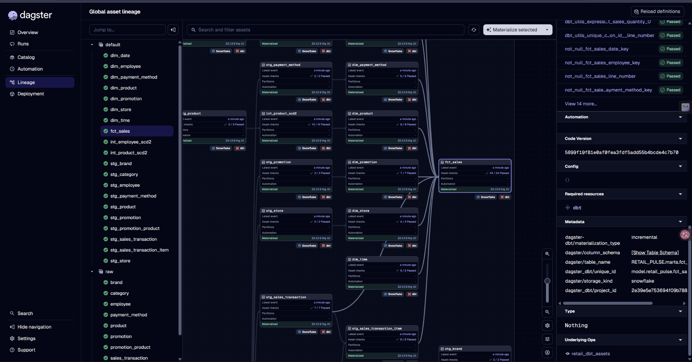

# Phase 6: Dagster (orchestrating dlt, dbt and quality checks)

## Why it is needed

After phase 5, the whole chain still runs by hand: `make ingest`, then `make dbt-build`, in the right order, every day.
Dagster puts it into one graph: it knows what runs first, runs on a schedule, stops at the right place on failure, and
shows the status and lineage of each table. Scope follows [Project-Spec, section 11](../Project-Spec.md#11-orchestration-specification).
Not done yet: automatic retries, alerts, sensors and deployment to a server.

Without it, a forgotten `make ingest` or a dbt run started before the load finished leaves the dashboard stale or
built on half-loaded data, and nobody notices.

## Concepts

| Concept | What it is | In this project |
|---|---|---|
| **Asset** | A piece of data that gets produced (a RAW table, a dbt model), with dependencies on other assets. Like a dbt model, but extended to the loading step too | 10 dlt RAW assets, 20 dbt assets |
| **Asset check** | A check attached to an asset | dbt tests; Great Expectations checks on RAW |
| **Job** | A named group of assets run together, ordered automatically by dependencies | `full_pipeline`, `fct_sales_full_refresh` |
| **Schedule** | Launches a job at a set time | Daily at 23:00 for `full_pipeline` |
| **Definitions** (`defs`) | The list of every asset, job and schedule Dagster knows about | `definitions.py` |
| **Code location** | The code package Dagster loads | module `retail_pulse.orchestration.definitions`, declared in `pyproject.toml` (`[tool.dagster]`) |
| **Daemon** | Background process that triggers schedules | started by `make dagster` |
| **Materialize** | Run an asset's code so the data it describes is produced or refreshed. Not the same as a dbt materialization (view, table) | **Materialize selected** in the UI, or a job run |

Further reading: [Assets](https://docs.dagster.io/guides/build/assets), [Jobs](https://docs.dagster.io/guides/build/jobs),
[Schedules](https://docs.dagster.io/guides/automate/schedules).

## Files

| File (`src/retail_pulse/orchestration/`) | What it does |
|---|---|
| `dlt_assets.py` | Each RAW table is an asset (step 1) |
| `dbt_assets.py` | Each dbt model is an asset (step 2) |
| `quality_checks.py` | Great Expectations checks attached to RAW assets, blocking dbt on failure ([phase 8](08-great-expectations.md)) |
| `jobs.py` | Two jobs and the schedule (steps 3, 4) |
| `definitions.py` | Collects everything into `Definitions` |

## Running

```bash
uv run dagster definitions validate -m retail_pulse.orchestration.definitions   # expected: Validation successful
make dagster                                                                    # opens the UI at http://localhost:3000
```

**The dbt manifest.** `@dbt_assets` reads `dbt/target/manifest.json` as soon as the code loads. `dagster dev` generates it
(`prepare_if_dev`), but `validate` and runs outside dev mode do not. *If it is missing* (after `make clean` or on a new
machine): error `DagsterDbtManifestNotFoundError: .../manifest.json does not exist`. Fix: run `make dbt-parse` first.

**Run history.** Without `DAGSTER_HOME`, run history is lost when Dagster stops. Set this variable (see `.env.example`)
to a fixed folder, for example `.dagster_home/` (already in `.gitignore`).

## Things to remember from earlier phases

- RAW is the only place that holds the SCD2 history of `product` and `employee`. The orchestration chain must **never**
  run dlt with `replace` or `refresh="drop_sources"` on those two tables.
- `fct_sales` fixes `-2` key rows with its own `--full-refresh` (the `fct_sales_full_refresh` job), without touching RAW.
- dbt runs from the `dbt/` folder and needs `SNOWFLAKE_ACCOUNT`, `DBT_PRIVATE_KEY_PATH` ([phase 5](05-dbt.md)). Dagster
  loads `.env` from the root folder, so **run Dagster from the repo root**.

## Step 1: dlt assets

```python
@dlt_assets(
    dlt_source=retail_source(),
    dlt_pipeline=retail_pipeline(),
    name="retail_raw", group_name="raw",
    dagster_dlt_translator=RetailDltTranslator(),
)
def retail_raw_assets(context, dlt_res: DagsterDltResource):
    yield from dlt_res.run(context=context)
```

- `@dlt_assets` turns each dlt **resource** (each table) into **its own asset**: 10 assets `raw/<table name>`. With
  separate assets, Dagster shows status, rows loaded and timing per table, and each dbt model can connect to exactly the
  table it reads.
- `retail_pipeline()` (in `ingestion/pipelines.py`) is the **single place** that defines the dlt pipeline. Both
  `make ingest` and Dagster use it, so the two cannot drift apart.
- `RetailDltTranslator` changes the asset key to `["raw", <table name>]`, which matches the default key of the dbt source
  `source('raw', 'store')`. So in step 2 the graph connects RAW to staging with no extra configuration.

## Step 2: dbt assets, and connecting lineage

```python
dbt_project = DbtProject(project_dir=Path(__file__).parents[3] / "dbt",
                         profiles_dir=os.environ.get("DBT_PROFILES_DIR", str(Path.home() / ".dbt")),
                         target="prod")
dbt_project.prepare_if_dev()

@dbt_assets(manifest=dbt_project.manifest_path)
def retail_dbt_assets(context, dbt: DbtCliResource):
    args = ["build"]
    if context.run.tags.get("full_refresh") == "true":   # see step 3
        args.append("--full-refresh")
    yield from dbt.cli(args, context=context).stream()
```

- `@dbt_assets` reads the manifest and turns **each dbt model into an asset** (20 models). Each `ref()` becomes a
  dependency arrow, so the Dagster graph matches the dbt DAG; new models appear as assets automatically.
- `dbt.cli(["build"])` runs a real `dbt build` underneath (models and tests) and attaches the results to each asset. dbt
  tests show up as **asset checks** on the right model, so you see at once which model has a failing test.
- Dagster uses the dbt-core in `.venv`, not the dbt in `~/.local/bin`.
- `target="prod"`: Dagster is the production pipeline and always builds `STAGING`, `INTERMEDIATE`, `MARTS`; the
  `DbtCliResource` inherits the target from `DbtProject`. A developer's `make dbt-build` uses `dev`
  ([phase 12](12-environments.md)), so the profile Dagster mounts must have a `prod` output.

**Lineage connects from Postgres to `fct_sales`**, verified on the graph (40 assets: 10 RAW assets, 20 dbt assets, and 10
`sql_database_<table>` assets created by dagster-dlt to represent the source tables in Postgres):

| Asset | Depends on |
|---|---|
| `staging/stg_store` | `raw/store` |
| `staging/stg_sales_transaction_item` | `raw/sales_transaction_item`, `staging/stg_sales_transaction` |
| `marts/fct_sales` | 7 dimensions (including `dim_date`, `dim_time`), the two sales staging models |

Asset names are schema plus model (the dbt key is `[schema, model]`); dlt assets are `raw/<table>`.

Screenshot of **Global asset lineage** after Materialize (`make dagster`, Lineage section, select assets, Materialize
selected):



In the screenshot: the left column groups assets into `default` (dbt assets) and `raw` (dlt assets); each node shows the
materialization time, the number of asset checks passed and a technology tag; the right panel (with `fct_sales` selected)
shows the list of checks and the metadata `materialization_type: incremental`,
`table_name: RETAIL_PULSE.marts.fct_sales`.

## RAW quality checks block dbt

Phase 8 attaches a `great_expectations` asset check to four RAW assets (`sales_transaction`, `sales_transaction_item`,
`product`, `employee`) with `blocking=True`: if a check fails, the downstream dbt assets **do not run**.

*Why:* a dbt build on dirty RAW still shows "green" but gives wrong numbers. Blocking at the entrance is cheaper than
finding the bug in the dashboard.
Further reading: [Asset checks](https://docs.dagster.io/guides/test/asset-checks).

## Step 3: Jobs

| Job | Asset selection | Use it for |
|---|---|---|
| `full_pipeline` | `retail_raw_assets` (dlt) and `retail_dbt_assets` (dbt) | Regular runs: dlt loads RAW, then a full `dbt build` (models and tests) |
| `fct_sales_full_refresh` | only `marts/fct_sales`, with tag `full_refresh=true` | Fixing `-2` key rows in the fact; does not run dlt, does not touch RAW |

**How a dbt asset knows to use `--full-refresh`:** the two jobs share the dbt assets and differ only in the run tag; the
asset reads that tag (the code in step 2). Dagster adds `--select` for the selected assets, so the full-refresh job runs
`dbt build --full-refresh --select retail_pulse.marts.fct_sales`. (One test run: 26/26 tests passed, `fct_sales` still
271,766 rows.) One asset with two run modes is used instead of two assets with the same key, because Dagster does not
allow two assets with the same key.

```bash
uv run dagster job execute -m retail_pulse.orchestration.definitions -j full_pipeline   # no UI needed
```
Or in the UI: **Jobs**, pick the job, **Launchpad**, **Launch Run**.

**Safety:** if the `full_refresh=true` tag is set on `full_pipeline` by mistake, every dbt model is rebuilt (harmless but
slower). RAW is never overwritten because this flag only affects dbt.

## Step 4: Schedule

| Decision | Choice | Reason |
|---|---|---|
| Scheduled job | `full_pipeline` | dlt loads RAW, then dbt builds |
| Frequency | Daily at 23:00, time zone `Asia/Ho_Chi_Minh` | Stores open 7:00 to 22:00, so running after closing captures the whole day's orders; a daily dashboard does not need fresher data |
| `fct_sales_full_refresh` | Not scheduled, run by hand | Only needed when there are `-2` key rows; rebuilding the whole table costs resources |
| What if dlt fails | dbt does not build | Dagster default, no extra configuration |

*Why dbt does not run when dlt fails, with no code for it:* the dbt assets depend on the dlt assets in the graph; when an
upstream asset fails, every downstream asset is skipped. On the other hand, if dlt succeeds and dbt fails, RAW already has
the new data, and next time you only need to rerun the dbt assets.

**The schedule only runs while the daemon runs.** `make dagster` starts the daemon, so the machine must be on and the
process alive at 23:00. Real production uses `dagster-daemon run` in the background (systemd or Docker), not
`dagster dev`. View and toggle schedules under **Automation**; the schedule sets `default_status=RUNNING`, so it is on by
default. To test without waiting for 23:00: open the schedule and use **Test Schedule**, or launch `full_pipeline` by hand.

Further reading: [Defining schedules](https://docs.dagster.io/guides/automate/schedules/defining-schedules),
[Dagster daemon](https://docs.dagster.io/guides/deploy/execution/dagster-daemon),
[Instance configuration](https://docs.dagster.io/guides/deploy/dagster-instance-configuration) (`DAGSTER_HOME`).

## Errors encountered

| Symptom | Cause | Fix |
|---|---|---|
| `No module named 'orchestration'` | Import missing the package name | Use `from retail_pulse.orchestration....` |
| `connection to server ... port 5432 failed` on `validate` while Postgres is down | `sql_database(...)` reads table structure from Postgres **at import time** (reflection) | `sql_database(..., reflection_level="full", defer_table_reflect=True)` |
| `ValidationError for DbtCliResource ... does not contain a profiles.yml` | `profiles.yml` is in `~/.dbt/`, but `DbtCliResource` only looks in the dbt project folder | Pass `profiles_dir` (default `~/.dbt`, overridden by `DBT_PROFILES_DIR`) |
| Same error as above, but only with `dagster dev` | `prepare_if_dev()` creates its own `DbtCliResource` from `DbtProject` | Set `profiles_dir` on `DbtProject` too, not only on the resource |
| `DagsterDbtManifestNotFoundError` | `dbt/target/manifest.json` does not exist yet | `make dbt-parse` |

**Lesson from the Postgres error:** code that runs at **import** must be cheap and must not depend on external systems;
work that needs a connection (reading structure, calling APIs, querying) should wait until **execution**. This is common
in every framework that loads code first and runs it later (Dagster, Airflow). `defer_table_reflect=True` is safe: the
extracted columns were compared with and without this option for three tables (`product`, `sales_transaction_item`,
`promotion`) and were identical (for example `unit_price`, `unit_cost` are both `decimal(12, 2)`), so RAW column types do
not change (if they did, dlt would add `..._v_text` columns that are very hard to clean up). Check it by loading the code
with no Postgres available: `PG_PORT=59999 uv run python -c "import retail_pulse.orchestration.dlt_assets"` must succeed.

**Lesson from the `profiles_dir` error:** `dagster definitions validate` does not cover steps that only run in dev mode,
so test with a real `dagster dev` too.

## Tests

`tests/test_orchestration.py`: each RAW table has one asset; both jobs exist with the right asset selection and tags
(`full_pipeline` contains `raw/product` and `marts/fct_sales`, the full-refresh job selects only `fct_sales`); the schedule
has the right cron and time zone.

## Possible improvements

- The 20 dbt assets share the `default` group; they could be grouped by layer (`staging`, `intermediate`, `marts`) by
  overriding `get_group_name` on `DagsterDbtTranslator`.
- Rename the 10 `sql_database_<table>` assets to something shorter with the translator's `get_deps_asset_keys`.
- Automatic retries, failure alerts, sensors, and deployment with `dagster-daemon` on a server.

Further reading: [dagster-dbt library](https://docs.dagster.io/api/libraries/dagster-dbt),
[dagster-dlt library](https://docs.dagster.io/api/libraries/dagster-dlt).

Next: [Phase 7: Preset](07-preset.md).
