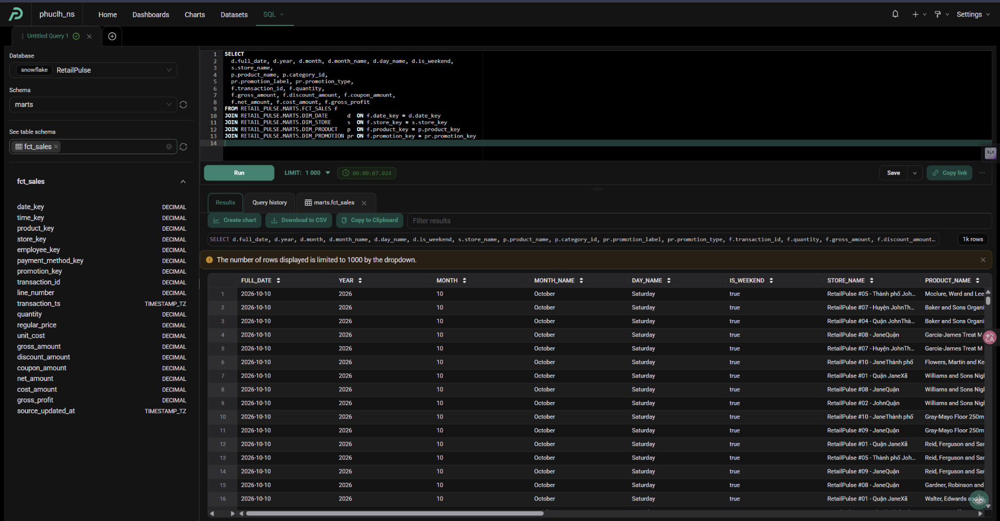
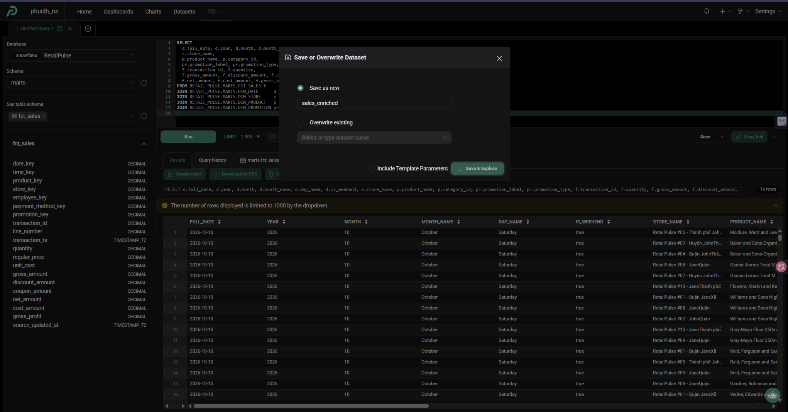
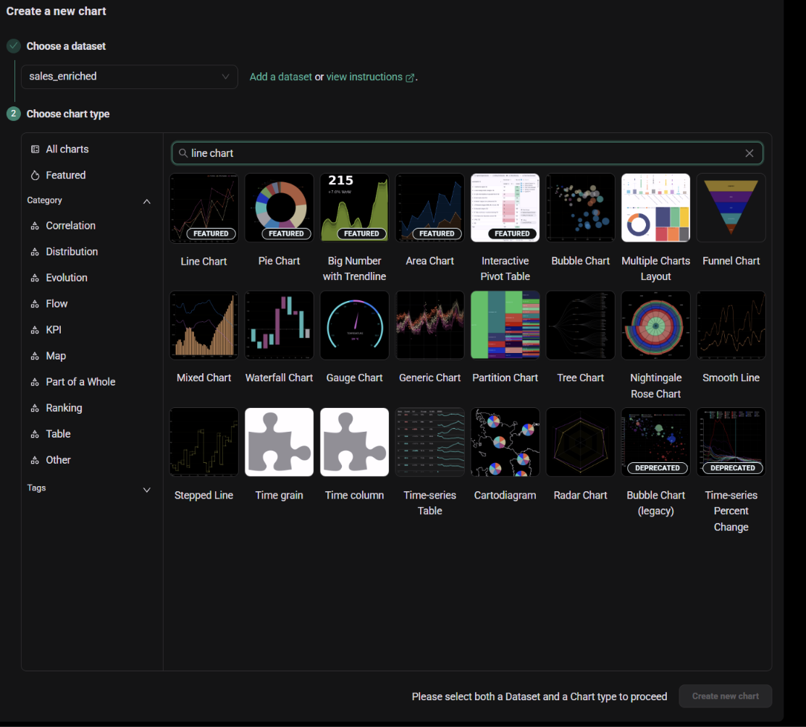
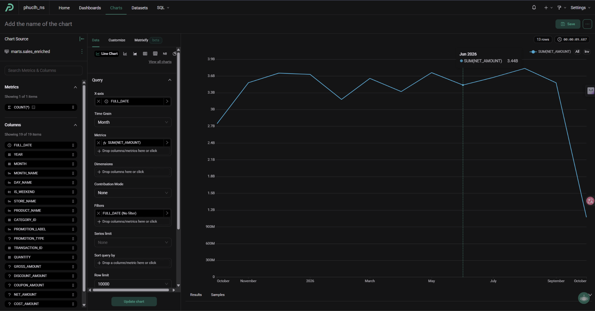
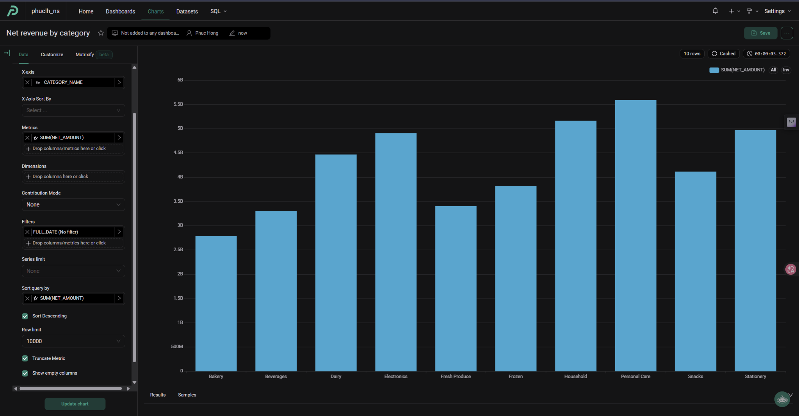
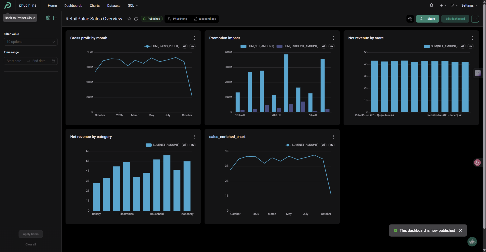

# Phase 7: Preset (dashboard)

The pipeline runs, but nobody sees the results yet. Preset is the last layer: it reads the mart tables in Snowflake and
turns them into a dashboard. The rule from [Project-Spec, section 12](../Project-Spec.md#12-bi-specification): Preset
**reads only the dbt marts**, never PostgreSQL or RAW.

Five steps: a read-only role, a Preset account, the Snowflake connection, the dataset, charts and dashboard.

## Step 1: A read-only role for Preset

*Why a separate role:* Preset only needs to read. Using `TRANSFORMER` would give an external tool write and delete
rights on both RAW and the marts. Keep it to the minimum: only `SELECT` on `MARTS`.

Run in Snowsight as `ACCOUNTADMIN` (the `MARTS` schema was already created by `make snowflake-init`):

```sql
USE ROLE ACCOUNTADMIN;
CREATE ROLE IF NOT EXISTS REPORTER;
GRANT ROLE REPORTER TO ROLE SYSADMIN;

GRANT USAGE ON WAREHOUSE RETAIL_WH TO ROLE REPORTER;
GRANT USAGE ON DATABASE RETAIL_PULSE TO ROLE REPORTER;
GRANT USAGE ON SCHEMA RETAIL_PULSE.MARTS TO ROLE REPORTER;
GRANT SELECT ON ALL TABLES IN SCHEMA RETAIL_PULSE.MARTS TO ROLE REPORTER;
GRANT SELECT ON FUTURE TABLES IN SCHEMA RETAIL_PULSE.MARTS TO ROLE REPORTER;
```

- **`FUTURE TABLES`:** dbt rebuilds tables on each run (`--full-refresh` creates a new table). The grant also covers
  tables created later. *If it is missing:* after each dbt rebuild, Preset reports it has no read permission.
- **Why this is kept out of `infras/snowflake/init.sql`:** Preset is optional, and not everyone running the project uses
  it. `init.sql` only holds what the pipeline requires (dlt, dbt, CI). To merge them, append the statements above to the
  end of `init.sql`; `MARTS` is already created there, so there is no ordering problem.

Create a user for Preset (set the password yourself in Snowsight, store it in `.env` as `PRESET_READER_PASSWORD`,
**never in the repo**):

```sql
CREATE USER IF NOT EXISTS PRESET_READER
  DEFAULT_ROLE = REPORTER
  DEFAULT_WAREHOUSE = RETAIL_WH
  PASSWORD = '<set a strong password>'
  MUST_CHANGE_PASSWORD = FALSE;
GRANT ROLE REPORTER TO USER PRESET_READER;
```

**Check:** log in as `PRESET_READER` (or `USE ROLE REPORTER`). `SELECT count(*) FROM RETAIL_PULSE.MARTS.FCT_SALES;`
must return a row count, and `SELECT * FROM RETAIL_PULSE.RAW.PRODUCT;` must be denied. The denial is what proves the
permissions are limited correctly.

Further reading: [Snowflake: access control overview](https://docs.snowflake.com/en/user-guide/security-access-control-overview),
[GRANT ... TO ROLE](https://docs.snowflake.com/en/sql-reference/sql/grant-privilege) (the `FUTURE` section).

## Step 2: Preset account

Sign up at [preset.io](https://preset.io) (free tier) and create a workspace. Preset is a managed Apache Superset
service, so every concept below (database, dataset, chart, dashboard) follows Superset.

## Step 3: Connect Snowflake

**Settings → Database Connections → + Database → Snowflake**, and fill in:

| Field | Value |
|---|---|
| Account | account identifier (same as `SNOWFLAKE_ACCOUNT`) |
| Username / Password | `PRESET_READER` and the password from step 1 |
| Role | `REPORTER` |
| Warehouse | `RETAIL_WH` |
| Database / Schema | `RETAIL_PULSE` / `MARTS` |

Click **Test Connection**. The warehouse auto-suspends after 60 seconds and is capped by the `RETAIL_RM` resource monitor
(10 credits/month), so the dashboard cannot raise costs unexpectedly.

**Error hit during setup:** the form reported `requested database does not exist or not authorized`, even though
Snowflake itself was fine (logging in as `PRESET_READER`, role `REPORTER`, database `RETAIL_PULSE` with the Python
connector worked). The problem is how the Preset form assembles the fields into a connection string. Fix: click
**Connect this database with a SQLAlchemy URI instead** and paste:

```text
snowflake://PRESET_READER:<password>@<account>/RETAIL_PULSE/MARTS?role=REPORTER&warehouse=RETAIL_WH
```

`<account>` has the form `orgname-accountname` (without the `.snowflakecomputing.com` suffix). This string names the
database, schema, role and warehouse explicitly, so it no longer depends on how the form assembles them. Do not take
screenshots while the password is visible.

Further reading: [Superset: connecting to Snowflake](https://superset.apache.org/docs/databases/supported/snowflake).

## Step 4: Dataset

> **Replaced in [phase 11](11-semantic-layer.md):** the virtual dataset below moved into dbt as
> `fct_sales_enriched`, and the charts use the metrics defined in dbt instead of hand-written `SUM(...)`.

Each dataset is a table or a SQL query. The fact only has keys, so create a **virtual dataset** named `sales_enriched`
that joins `fct_sales` with four dimensions, so charts have store, product, date and promotion names. Go to **SQL**,
pick the `RetailPulse` database and the `marts` schema, and run:

```sql
SELECT
  d.full_date, d.year, d.month, d.month_name, d.day_name, d.is_weekend,
  s.store_name,
  p.product_name, p.category_name, p.brand_name,
  pr.promotion_label, pr.promotion_type,
  f.transaction_id, f.quantity,
  f.gross_amount, f.discount_amount, f.coupon_amount,
  f.net_amount, f.cost_amount, f.gross_profit
FROM RETAIL_PULSE.MARTS.FCT_SALES f
JOIN RETAIL_PULSE.MARTS.DIM_DATE      d  ON f.date_key = d.date_key
JOIN RETAIL_PULSE.MARTS.DIM_STORE     s  ON f.store_key = s.store_key
JOIN RETAIL_PULSE.MARTS.DIM_PRODUCT   p  ON f.product_key = p.product_key
JOIN RETAIL_PULSE.MARTS.DIM_PROMOTION pr ON f.promotion_key = pr.promotion_key
```



- **Join directly on `*_key`, without filtering on `valid_from`/`valid_to` again:** the fact already points to the right
  SCD2 version.
- **A plain `JOIN` is enough** because every dimension has a `-2` or `-1` row, so no fact row is lost. Check: the result
  row count must equal the `FCT_SALES` row count. SQL Lab shows only 1,000 rows by default, so count with an outer
  `SELECT count(*)` instead of looking at the displayed rows.
- **Save:** the arrow next to **Save**, **Save dataset**, name it `sales_enriched`, **Save & Explore**.



Rows with a `-2` key show as "Unknown", and `-1` in promotion shows as "No promotion"; all labels are in English.
`dim_product` has `category_name` and `brand_name` (Type 1, current name) so category charts show names instead of IDs.
*When dbt adds a new column to a dimension*, edit the dataset SQL and **Save** again so Preset picks up the column.

## Step 5: Charts and dashboard

Topics from the spec (section 12), one group of charts each:

| Topic | Chart |
|---|---|
| Revenue and trends | Line: `sum(net_amount)` by month |
| Products and categories | Bar: revenue by category |
| Stores | Bar: revenue by `dim_store` |
| Promotion effectiveness | Bar: `sum(discount_amount)` and revenue by `dim_promotion` |
| Gross margin | Line: `sum(gross_profit)` by month (uses the cost at the time of sale) |

**First chart, revenue by month:** **Charts, + Chart**, pick the `sales_enriched` dataset and the **Line Chart** type.



Configuration: X-axis `FULL_DATE`, Time Grain `Month`, Metric `SUM(NET_AMOUNT)`.



Revenue is around 3 to 3.8 billion per month. The two lower points at either end are **partial months** (the month the
data starts and the current month), not a pipeline error. On the dashboard, filter out the current month or add a note so
viewers do not read it as a revenue drop.

**The other charts** use the same `sales_enriched` dataset. For grouped bar charts, put the category column on the
**X-axis** (the **Dimensions** field only splits each bar into colors):

| Chart | Type | Configuration |
|---|---|---|
| Net revenue by category | Bar | X-axis `CATEGORY_NAME`, metric `SUM(NET_AMOUNT)`, sort descending |
| Net revenue by store | Bar | X-axis `STORE_NAME`, metric `SUM(NET_AMOUNT)` |
| Promotion impact | Bar | X-axis `PROMOTION_LABEL`, metrics `SUM(NET_AMOUNT)` and `SUM(DISCOUNT_AMOUNT)`, filter `PROMOTION_LABEL <> 'No promotion'`, row limit 20 |
| Gross profit by month | Line | X-axis `FULL_DATE` (Month), metric `SUM(GROSS_PROFIT)` |



**Dashboard:** **Dashboards, + Dashboard**, name it `RetailPulse Sales Overview`, **Edit dashboard**, drag charts from
the **Charts** tab onto the canvas, and add two filters in the left sidebar: **Value** on `STORE_NAME` and **Time range**
on `FULL_DATE`. **Save**, then **Publish**.



Further reading: [Superset: creating your first dashboard](https://superset.apache.org/docs/using-superset/creating-your-first-dashboard),
[Preset docs](https://docs.preset.io/).

## Reconciling numbers with the warehouse

A dashboard is only trustworthy when it matches the source tables. Checked as `PRESET_READER`:

| Metric | In `FCT_SALES` | On the dashboard |
|---|---|---|
| Total `net_amount` | 42.53 billion | The bars by category, by store, and the monthly points all add up to about 42.5 billion |
| Total `gross_profit` | 12.51 billion (29.4% gross margin) | The monthly chart is around 0.8 to 1.1 billion per month |

The three breakdowns (category, store, month) add up to the same total, which means the dimension joins neither drop nor
duplicate fact rows.

## What to know when reading the dashboard

- **The first and last months are lower** because they are partial. The **Time range** filter removes them.
- **Promotion impact has only 8 bars even though there are 40 promotions.** The chart groups by `promotion_label` (for
  example "10% off"), and many promotions share a label, so they are merged. To see each promotion, add a promotion name
  or code column to `dim_promotion`.
- **Revenue across the 10 stores is nearly equal (about 4.2 billion each).** This is a property of the fake data from the
  generator, not a modeling bug.
- The dashboard still has a chart with the default name `sales_enriched_chart` (created by *Save & Explore*); rename it to
  `Net revenue by month`.

## Notes

- The numbers only update when `full_pipeline` runs (daily at 23:00, see [phase 6](06-dagster.md)). Preset only reads
  the results; it does not trigger the pipeline.
- Do not commit passwords or Preset connection details to the repo.

Next: [Phase 8: Great Expectations](08-great-expectations.md).
